# Padrões de projeto em Java puro: Singleton, Strategy e Facade

[](https://github.com/barbozadevti/java-padroes-projeto/actions/workflows/ci.yml)

Entrega do desafio de projeto **"Explorando Padrões de Projeto na Prática com Java"**, da [DIO](https://www.dio.me). Reproduz os três padrões do [laboratório de referência](https://github.com/digitalinnovationone/lab-padroes-projeto-java), com melhorias e testes.

> Versão completa para portfólio: **[barbozadevti/brasa](https://github.com/barbozadevti/brasa)**, uma plataforma de pedidos para restaurantes em que cada decisão do negócio é um padrão GoF em Java (Composite, Decorator, Builder, Strategy, Chain of Responsibility, State, Observer, Adapter, Command, Facade e Template Method).



## Os padrões

| Padrão | Problema que resolve | Aqui |
|---|---|---|
| **Singleton** | Garantir uma única instância de algo compartilhado | Três variações do laboratório (`SingletonLazy`, `SingletonEager`, `SingletonLazyHolder`) e a forma com `enum` (`Configuracao`) |
| **Strategy** | Trocar um algoritmo sem mudar quem o usa | `Robo` delega o movimento a um `Comportamento`; trocar a estratégia não exige nenhum `if` dentro de `mover()` |
| **Facade** | Esconder vários subsistemas atrás de uma chamada simples | `Facade.migrarCliente` consulta o CEP e grava no CRM; quem chama não conhece nenhum dos dois |

## O que foi além do laboratório

- **Singleton e threads:** o `SingletonLazy` sem sincronização pode criar duas instâncias se duas threads chegarem juntas. O `Lazy Holder` e o `enum` resolvem isso, e um teste comprova com **200 threads ao mesmo tempo**.
- **Singleton com `enum`**, a forma recomendada em *Effective Java*: segura contra reflexão e serialização, e com um uso real (configuração e contador de acessos sem perda em paralelo).
- **Strategy com lambdas:** `Comportamento` é uma interface funcional, então uma estratégia nova pode ser uma linha: `robo.setComportamento(() -> "Desviando de obstáculos...")`.
- **Strategy escolhida pelo contexto:** `ajustarPelaEnergia` troca o comportamento conforme a energia do robô.
- **Facade com validação:** CEP desconhecido ou nome vazio não chegam ao CRM.
- **Testes** em Java puro, rodando no GitHub Actions a cada envio.

## Como rodar

Requer o JDK 21.

```bash
javac -encoding UTF-8 -d out $(find src -name "*.java")
java -cp out dev.barboza.padroes.Main
```

```text
== Singleton ==
Lazy: mesma instância? true
Eager: mesma instância? true
Lazy Holder: mesma instância? true
Enum: ambiente desenvolvimento, acessos 2

== Strategy ==
Movendo-se normalmente...
Movendo-se agressivamente...
Movendo-se defensivamente...
Desviando de obstáculos...

== Facade ==
Cliente[nome=Rafael Barboza, cep=29055460, cidade=Vitória, estado=ES]
Cliente[nome=Ana Souza, cep=01310100, cidade=São Paulo, estado=SP]
```

## Testes

```bash
bash tests/testar.sh
```

12 testes: unicidade dos Singletons (inclusive com 200 threads), construtores privados, contador sem perda em paralelo, troca de estratégia, estratégia por lambda e pela energia, Facade gravando e recusando dados inválidos, e a demonstração completa.
